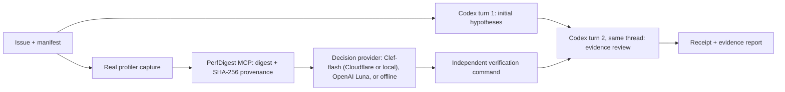

# PerfDigest Evidence

**Collect performance evidence while Codex investigates. Keep every conclusion tied to a report and an independent verification result.**

[](https://github.com/onlyxItachi/perfdigest-plugin/actions/workflows/ci.yml)

A Codex-first hackathon MVP for HPC performance debugging, distributed as `perfdigest-plugin` (TypeScript 6, Node.js 22+). Real profiler measurements are digested by the Python [PerfDigest MCP](https://github.com/onlyxItachi/PerfDigest-MCP). A lightweight decision model then selects the most relevant **measured** report. Codex reviews that evidence, plus an independent verifier result, in the next turn of the same thread. The coding agent gets verifiable facts instead of searching profiler output blindly.

## Pipeline



- The evidence worker runs asynchronously alongside the first Codex turn. Evidence is delivered in the **next turn of the same thread**; nothing is injected into hidden reasoning.
- The decision model chooses among existing measured reports, or abstains. It does not invent profiler commands or apply patches.
- Verification is an explicit command. Model confidence can never turn a failed verifier into a pass, and provider errors never silently fall back to another provider or a fixture.
- Codex runs through the official [Codex SDK](https://developers.openai.com/codex/sdk) using your existing ChatGPT/Codex login. No tokens are copied.

## What has actually been validated (12 October 2026)

| Path | Result | Record |
| --- | --- | --- |
| **Cloudflare Workers AI Clef-flash → Codex** | 1 genuine hosted request: 2.588 s decision latency, selected `traversal-timing` (p = 0.9072). Two Codex turns (gpt-6-astra/max) in the same thread; independent verifier passed; 90.461 s end to end. No fallback, no patch. | [VALIDATION.md](docs/VALIDATION.md), [recorded receipt](examples/recorded-cloudflare/) |
| **Local Clef-flash Q4_K_M (llama.cpp, Vulkan, RTX 4060 Laptop)** | Genuine local inference passed native question checks. On real evidence it returned confidence 0.543, below the unchanged 0.65 policy, so the pipeline correctly reported **`needs_review`**. Verifier exit 0. The threshold was not lowered and nothing was retried. | [VALIDATION.md](docs/VALIDATION.md#genuine-local-clef-qualification) |
| OpenAI Decisions (`gpt-6-luna`) | Real loopback HTTP E2E with measured evidence, plus an intentionally invalid-key 401 check. **Valid-key inference not yet validated.** | [REFERENCE.md](docs/REFERENCE.md#decisions-authentication-and-deferred-integration) |
| Offline (deterministic) | Real CPU capture → PerfDigest MCP → verifier, no model calls | CI |
| Engineering | 57 contract tests, real-MCP checks, clean npm-archive install and MCP discovery run in GitHub Actions without credentials | [CI](https://github.com/onlyxItachi/perfdigest-plugin/actions/workflows/ci.yml) |

These results come from one controlled CPU example (row-major vs column-major matrix traversal). They do **not** establish root-cause accuracy, provider calibration, speedup, a solved PyTorch issue or GPU-profiling support.

## Quick start

Requirements: Node.js 22+, npm, Python 3.11+ and [uv](https://docs.astral.sh/uv/). Linux is the validated platform.

```bash
git clone https://github.com/onlyxItachi/perfdigest-plugin && cd perfdigest-plugin
npm ci && npm run build
uv tool install perfdigest-mcp==1.2.0 --with mcp==1.27.2
npm run demo            # real CPU capture + PerfDigest MCP + verifier; no model calls
```

**Replay the recorded Cloudflare/Codex run.** No credentials and no new inference are needed; it re-digests the original trace and reruns the verifier:

```bash
node dist/cli.js run examples/recorded-cloudflare/manifest.json \
  --workspace examples/recorded-cloudflare --provider offline --agent none
```

**Choose a decision provider** with the interactive CLI/TUI menu (Cloudflare, local llama.cpp, OpenAI or explicit offline). No hosted call is made unless you opt in:

```bash
npx --no-install perfdigest-plugin init                  # interactive menu
perfdigest-plugin init --provider offline --yes          # noninteractive
```

**Run a real Codex review** with your existing ChatGPT login: `npm run demo -- --agent codex --routing offline`.

**Install the local package archive.** It is not published to the npm registry:

```bash
npm pack
npm install --prefix /path/to/local-tools ./perfdigest-plugin-0.1.0.tgz
export PATH="/path/to/local-tools/node_modules/.bin:$PATH"
perfdigest-plugin demo
```

## Documentation

| Document | Contents |
| --- | --- |
| [docs/SETUP.md](docs/SETUP.md) | Provider selection, private credential files, connection checks |
| [docs/HACKATHON.md](docs/HACKATHON.md) | Submission walkthrough and reproduction without hosted credentials |
| [docs/VALIDATION.md](docs/VALIDATION.md) | Recorded hosted and local Clef runs, hashes, timings and claim boundaries |
| [docs/EVALUATION.md](docs/EVALUATION.md) | Controlled A/B/C evidence-delivery protocol and what it does not prove |
| [docs/REFERENCE.md](docs/REFERENCE.md) | Full technical reference: providers, manifests, Decisions security, npm/Codex plugin, MCP tools, CI |
| [examples/recorded-cloudflare/](examples/recorded-cloudflare/) | Original trace, bounded decision request, sanitized receipt |

## Security boundaries

Provider credentials (`PERFDIGEST_CLOUDFLARE_*`, `PERFDIGEST_DECISIONS_API_KEY`) are read only from a private env file outside the repository (mode 600). They are excluded from the Codex, capture, verifier and Python MCP child environments, and never appear in receipts or logs. Public CI uses no hosted credentials. This is environment isolation, not an OS-level sandbox.

## Future Update Trajectories

- **GPU and compiler evidence:** CUDA/CUTLASS profiling and real PyTorch/compiler performance issues, validated on hardware before any support claim.
- **Advanced orchestration:** iterative evidence planning where the decision model proposes the next measurement, with prioritization, repeated measurement and stronger A/B/C evaluation.
- **Multi-agent:** add explicit roles and handoffs after the Codex-first path is validated.
- **Additional agent runtimes / Hermes/auth:** investigate additional agent authentication in a later release; no Hermes integration is present in this MVP.
- **Platform compatibility:** validate GPU/CUDA/ROCm, macOS/Windows and TypeScript 7 separately, without turning missing hardware measurements into support claims.

Apache-2.0. Built on [PerfDigest MCP](https://github.com/onlyxItachi/PerfDigest-MCP), the [Codex SDK](https://developers.openai.com/codex/sdk), [Cloudflare Workers AI Clef-flash](https://developers.cloudflare.com/workers-ai/models/clef-flash/) and the [OpenAI Decisions API](https://developers.openai.com/api/docs/guides/decisions).
