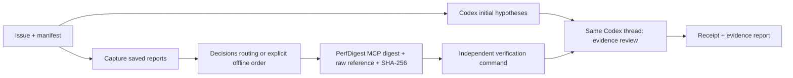

# PerfDigest Evidence

**Collect performance evidence while Codex investigates. Keep every conclusion tied to a report and an independent verification result.**

A Codex-first hackathon MVP for HPC infrastructure performance debugging. It combines the existing Python [PerfDigest MCP](https://github.com/onlyxItachi/PerfDigest-MCP), a small TypeScript runner, an asynchronous MCP worker and a Codex skill. The Decisions adapter uses the official OpenAI TypeScript SDK directly.

**Current validation:** real local CPU capture, PerfDigest MCP and a two-turn Codex SDK session have run successfully. Decisions requests are validated with synthetic HTTP fixtures; **live Decisions access is pending API credits**. The npm package is a local pre-release, not an npm registry release. GPU/PyTorch debugging and A/B/C performance benefits are not yet demonstrated.

## Quick start

Requirements: Node.js 22+, npm, Python 3.11+ and [uv](https://docs.astral.sh/uv/). TypeScript **6.0.3** and JavaScript dependencies are pinned in `package-lock.json`. Linux is the validated platform.

From this checkout:

```bash
npm ci
npm run build
uv tool install perfdigest-mcp==1.2.0
npm run demo
```

The demo performs genuine CPU work, saves a Chrome trace, digests it through `uvx perfdigest-mcp`, and verifies both traversal algorithms against an independent arithmetic formula. It makes **no model calls** by default. `--perf` additionally collects Linux process counters when `perf` and the required permissions are available. It fails explicitly if capture is unavailable.

For a real Codex review using your existing ChatGPT login:

```bash
codex login status
npm run demo -- --agent codex --routing offline
```

The runner finds the existing `codex` on `PATH`; `PERFDIGEST_CODEX_PATH` can select another existing binary. It requires ChatGPT authentication and does not copy login tokens. An optional `--model` selects a model available to that login; otherwise the existing Codex configuration determines the model. Codex usage is still consumed in this mode. Tested with CLI/SDK **0.162.1**.

## Evidence flow



The worker starts before the first model turn is requested. Evidence is delivered in the next turn of the **same** Codex thread. This is ordinary evidence handoff; nothing is injected into hidden reasoning. The timeline measures actual overlap with `turn.started`. Fast evidence can finish before the model begins; that correctly records zero overlap.

PerfDigest supplies measurements. Decisions selects one report to inspect from up to eight declared reports, or abstains. Codex examines the hypothesis and alternatives. Verification is an explicit command whose result cannot be overridden by confidence or model prose. This MVP applies no patches and has no generic provider framework.

| Mode | Routing | Model access | Evidence |
| --- | --- | --- | --- |
| Default demo | First declared report, deterministic | None | Real CPU execution + Python MCP |
| `--agent codex --routing offline` | First declared report | Existing ChatGPT Codex session | Real local evidence, then Codex review |
| `--agent codex --routing decisions` | Official Decisions API | Separate Decisions key + ChatGPT Codex | Adapter implemented; live Decisions validation pending |
| `npm test` | Synthetic fixtures where needed | No network/model requests | Contract and failure tests; not a live API result |

## Use your own reports

```json
{
  "version": 1,
  "issue": "Why did this CPU workload slow down?",
  "captures": [],
  "reports": [{
    "id": "cpu",
    "path": "reports/cpu.perf-stat.json",
    "format": "perf-stat-json",
    "description": "CPU cycles and instructions from the reproducer"
  }],
  "verification": {
    "command": "python3",
    "args": ["tests/verify_reproducer.py"],
    "timeoutMs": 30000
  }
}
```

```bash
node dist/cli.js run manifest.json --workspace /path/to/project --routing offline --agent codex
```

Reports are existing files inside the workspace, at most 20 MiB each, with an explicit PerfDigest format. Directory-shaped reports are outside this MVP. An optional `captures` list accepts up to four `{command, args, timeoutMs}` entries; commands run without a shell and must succeed and refresh the declared reports. Only run manifests whose commands you trust. Verification is required even when using saved reports. Capture/verification commands use a limited environment; activate a needed toolchain through its executable path or `PATH`.

Each run saves `.perfdigest/runs/<id>/run.json` and `report.md`: command receipts, report hashes, raw references, missing metrics, route provenance, Codex usage, errors and timestamps. Raw reports remain on disk. A failed or cancelled capture, changed report, empty digest or failed verification produces a failed run. Abstention/low routing confidence produces `needs_review`. Both exit nonzero. `complete` means the declared pipeline succeeded, not that an arbitrary diagnosis or patch was proved correct.

Missing measurements remain `null`. Billing is not observed, so `costUsd` stays `null`; token usage is reported only when provided by the service. The controlled CPU demo is not a real PyTorch issue and one timing sample is not a speedup claim.

## Decisions authentication and deferred integration

The adapter calls `client.decisions.create()` with `gpt-6-luna`, one explicit choice question, a 20-second timeout and no retries. Only issue text and report IDs, formats and descriptions go into routing; raw report contents and local paths are not sent to Decisions. Refusal, unknown choices, invalid confidence, HTTP errors and cancellation never silently switch to offline success. The 0.65 confidence cutoff is a routing policy, not a correctness threshold.

Use **`PERFDIGEST_DECISIONS_API_KEY`** in the standalone runner's environment. The adapter never falls back to `OPENAI_API_KEY`. Keep its env file outside the investigated repository and protect it with mode 600. Node can load that file for the runner without putting the key on the command line:

```bash
node --env-file=/absolute/private/decisions.env dist/cli.js demo --agent codex --routing decisions
```

The runner supplies an explicit child-environment allowlist to Codex, profiler commands and Python MCP. It omits Decisions and generic API credentials while preserving `HOME`/`CODEX_HOME` for the existing login. Inherited MCP servers are disabled for the runner's Codex calls with per-process overrides; global configuration is not edited. This controls environment inheritance, not OS-level access by code already running as your user.

Live integration is **opt-in and excluded from CI**. After credits/access are resolved, enable the one-request routing check explicitly:

```bash
PERFDIGEST_RUN_LIVE_DECISIONS=1 node --env-file=/absolute/private/decisions.env scripts/check-decisions-live.mjs
```

Without that flag it prints `SKIPPED` and sends nothing. A successful routing check would still not validate the full Codex + Decisions workflow; run the full demo separately afterward.

## npm package and Codex plugin

```bash
npm pack
npm install --prefix /path/to/local-tools ./perfdigest-plugin-0.1.0.tgz
export PATH="/path/to/local-tools/node_modules/.bin:$PATH"
perfdigest-plugin demo
```

This installs into your chosen prefix. Ensure this executable and `uvx` are on the `PATH` of the Codex process that loads the plugin. The package includes `.codex-plugin/plugin.json`, `.mcp.json` and `skills/perfdigest-evidence/SKILL.md`.

To register the checkout as a local Codex marketplace after installing the executable:

```bash
npm run plugin:prepare
codex plugin marketplace add /absolute/path/to/perfdigest-plugin
codex plugin add perfdigest-evidence@perfdigest-local
```

The preparation step copies only plugin metadata and the skill into `work/codex-plugin`; the marketplace points there, keeping dependencies and run receipts out of Codex's plugin cache. Registration updates the Codex configuration of the invoking user. Installation/listing and both MCP registrations have been checked with CLI 0.162.1 in a separate Codex configuration. Desktop UI activation is not yet validated. See the [official local plugin instructions](https://developers.openai.com/plugins/build/plugins#install-a-local-plugin-manually).

The evidence MCP provides three tools:

| Tool | Behavior |
| --- | --- |
| `launch_evidence_prefetch` | Return a job ID immediately; digest existing reports asynchronously. Offline by default. |
| `get_evidence_job` | Poll with at most 5 seconds of waiting; consume the terminal result once. |
| `cancel_evidence_job` | Abort collection and release the job slot. |

Jobs have a 90-second deadline, expire after five minutes, and are limited to 32 retained jobs. This MCP surface does not expose arbitrary capture commands. The bundled Python MCP also supplies lazy metric expansion and comparison. Plugin MCP Decisions mode needs a key in its **own server process**; do not export the key into the parent Codex session. Use the standalone runner for the documented separate-auth full workflow.

## Development and CI

```bash
npm test                 # SDK HTTP fixtures, subprocess and MCP failure tests; no model calls
npm run test:local       # Real Python MCP discovery, CPU capture and verification
npm run test:package     # Actual tarball, clean prefix install, real offline demo and MCP discovery
npm run check            # All of the above, including the TypeScript build
npm run test:decisions-live  # Skipped unless explicitly enabled
```

GitHub Actions runs these non-model checks on Linux/Node 22 with pinned action revisions and read-only repository permissions. No API key or Codex login is required. Hosted CI status must be checked on the actual GitHub run; a local pass is not a hosted CI pass.

The intended comparison is A: ordinary tools, B: PerfDigest digests, C: Decisions + PerfDigest + early evidence. Measure elapsed time, observed token usage, independently billed cost and independently verified correctness on the same task. That comparative evaluation and the real PyTorch demo issue remain future work.

## Future Update Trajectories

- **Multi-agent:** add explicit roles and handoffs after the Codex-first path is validated.
- **Hermes/auth:** investigate additional agent authentication in a later release; no Hermes integration is present in this MVP.
- **Advanced orchestration:** iterative evidence planning, prioritization, repeated measurement and stronger A/B/C evaluation.
- **Platform compatibility:** validate GPU/CUDA/ROCm, macOS/Windows and TypeScript 7 separately, without turning missing hardware measurements into support claims.

Apache-2.0. Built on [PerfDigest MCP](https://github.com/onlyxItachi/PerfDigest-MCP), the [Codex SDK](https://developers.openai.com/codex/sdk) and the [OpenAI Decisions API](https://developers.openai.com/api/docs/guides/decisions).
