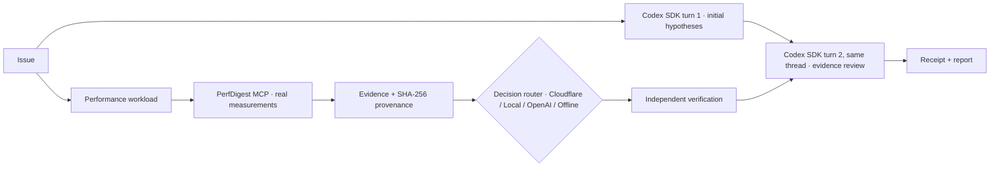

# PerfDigest Evidence

*Evidence-first performance debugging for coding agents.*

[](https://github.com/onlyxItachi/perfdigest-plugin/actions/workflows/ci.yml) [](https://github.com/onlyxItachi/perfdigest-plugin/releases/tag/v0.1.0-hackathon)

**PerfDigest Evidence collects real profiler measurements while Codex investigates. It then hands Codex the most relevant measured report, with SHA-256 provenance and an independent verification result, so the agent reasons from verifiable facts instead of searching raw profiler output.**

- **Existing engine:** [PerfDigest MCP](https://github.com/onlyxItachi/PerfDigest-MCP) (Python, published on PyPI) turns profiler reports into structured, hashed metrics.
- **New in this hackathon:** `perfdigest-plugin` (TypeScript 6, Node.js 22+). It adds the async evidence worker, the decision router, the same-thread Codex SDK handoff, independent verification, receipts, a CLI/TUI, and Codex plugin packaging.

## The problem

Performance debugging requires expensive, fragmented evidence gathering: profilers, traces and counters, each in its own format. Coding agents either guess or spend their context reading raw dumps, and their conclusions are rarely tied back to a measurement.

## Architecture



- Evidence collection runs **asynchronously** alongside Codex's first turn. Results are delivered in the **next turn of the same thread**; nothing is injected into hidden reasoning.
- The router **selects among already-measured reports**, or abstains. It does not choose new profiler commands or apply patches.
- Verification is an explicit command. Provider confidence can never turn a failed verifier into a pass, and errors never silently fall back to another provider.

## Proof, not promises

Recorded on 12 October 2026, from **one controlled CPU example** (row- vs column-major matrix traversal):

| What | Observed result | Evidence |
| --- | --- | --- |
| Cloudflare Clef-flash → Codex | 1 genuine hosted decision selected `traversal-timing`. Codex (gpt-6-astra/max) then reviewed it in turn 2 of the same thread. No fallback, no patch. | [Receipt](examples/recorded-cloudflare/receipt.json) · [Validation](docs/VALIDATION.md#genuine-cloudflare-clef-and-codex-run) |
| Latency | **2.588 s** decision · **90.461 s** end-to-end wall time (single run) | [Validation](docs/VALIDATION.md#genuine-cloudflare-clef-and-codex-run) |
| Independent verification | **Exit 0**: both traversals match an independent arithmetic formula | [Recorded demo](examples/recorded-cloudflare/) |
| Local Clef-flash Q4_K_M (RTX 4060 Laptop, Vulkan) | Real local inference. Confidence 0.543 was below the unchanged 0.65 policy, so the run correctly ended **`needs_review`**. | [Local qualification](docs/VALIDATION.md#genuine-local-clef-qualification) |
| Engineering | **57/57** contract tests, real MCP check, clean install of the package archive, green GitHub Actions without credentials | [CI run](https://github.com/onlyxItachi/perfdigest-plugin/actions/runs/38247676550) · [Evaluation method](docs/EVALUATION.md) |

**Three different signals.** In the Cloudflare run, the **selection probability** for `traversal-timing` was 0.9072: how strongly the model preferred that option. The **provider confidence** was 0.6632: Clef's SystemOne score, which is 0 at a uniform distribution and is not calibrated. Neither number is correctness. Only the **independent verifier** (exit 0) is checked, and it validates the workload's arithmetic, not the causal explanation.

This is a single-report, single-run demonstration. It does **not** establish routing accuracy, diagnosis quality, speedup, a solved PyTorch issue or GPU-profiling support. OpenAI Decisions has been tested only against a loopback mock (no valid-key inference).

## Quick start

Requirements: Node.js 22+, Python 3.11+, [uv](https://docs.astral.sh/uv/). Linux is the validated platform. The package archive is attached to the [v0.1.0-hackathon prerelease](https://github.com/onlyxItachi/perfdigest-plugin/releases/tag/v0.1.0-hackathon); it is **not** published to the npm registry.

```bash
# 1. Install the prerelease archive into a local prefix
curl -LO https://github.com/onlyxItachi/perfdigest-plugin/releases/download/v0.1.0-hackathon/perfdigest-plugin-0.1.0.tgz
npm install --prefix ~/pd-tools ./perfdigest-plugin-0.1.0.tgz
export PATH="$HOME/pd-tools/node_modules/.bin:$PATH"
uv tool install perfdigest-mcp==1.2.0 --with mcp==1.27.2

# 2. Real CPU capture -> PerfDigest MCP -> verifier (no model calls, no credentials)
perfdigest-plugin init --provider offline --yes
perfdigest-plugin demo
```

Replay the recorded Cloudflare run from source. This needs no credentials and makes no new inference; it re-digests the original trace and reruns the verifier:

```bash
git clone https://github.com/onlyxItachi/perfdigest-plugin && cd perfdigest-plugin
npm ci && npm run build
node dist/cli.js run examples/recorded-cloudflare/manifest.json \
  --workspace examples/recorded-cloudflare --provider offline --agent none
```

Choose a provider interactively with `npx --no-install perfdigest-plugin init`. For a real Codex review with your existing ChatGPT login, run `perfdigest-plugin demo --agent codex --provider offline`. See [docs/SETUP.md](docs/SETUP.md) for provider configuration, private credential files and authentication.

## Bring your own key (BYOK)

**You provide your own credentials only for hosted decision inference.** Cloudflare Clef-flash uses a Workers AI account ID and API token; OpenAI Decisions requires a separate OpenAI Platform API key and available API billing. **Local Clef (llama.cpp) and offline routing require no API key.** Codex review is separately authenticated through your existing ChatGPT/Codex login.

Keep credentials **outside the repository** in a private env file (Unix permissions `600`), never in commits, command arguments, setup JSON or demo receipts. For Cloudflare, create an external file such as `/absolute/private/perfdigest.env` containing:

```dotenv
PERFDIGEST_CLOUDFLARE_ACCOUNT_ID=YOUR_CLOUDFLARE_ACCOUNT_ID
PERFDIGEST_CLOUDFLARE_API_TOKEN=YOUR_WORKERS_AI_TOKEN
```

Then configure the installed CLI (on `main`, you may also pass `--decision-model clef-flash|clef|clef-omni`; `clef-flash` is the default):

```bash
chmod 600 /absolute/private/perfdigest.env
perfdigest-plugin init --provider cloudflare --env-file /absolute/private/perfdigest.env --yes
perfdigest-plugin demo --provider cloudflare --agent codex
```

For OpenAI Decisions, use `PERFDIGEST_DECISIONS_API_KEY` in a **separate private env file** and select `--provider openai`. For free local usage, choose `--provider local` with a running compatible Clef server, or `--provider offline` for deterministic routing. Provider setup, token permissions, optional connection checks and local server instructions are in **[the provider setup guide](docs/SETUP.md)**. **GitHub CI never needs real API keys.**

## Documentation

| Topic | Link |
| --- | --- |
| Getting started | [docs/SETUP.md](docs/SETUP.md) |
| Hackathon demo | [docs/HACKATHON.md](docs/HACKATHON.md) |
| Measurements & evaluation | [docs/EVALUATION.md](docs/EVALUATION.md) |
| Runtime & MCP session-reuse benchmarks | [docs/BENCHMARKS.md](docs/BENCHMARKS.md) |
| Real workload evaluation (CUDA, C++, PyTorch, Linux perf) | [docs/REAL_WORKLOAD_EVALUATION.md](docs/REAL_WORKLOAD_EVALUATION.md) |
| Validation & compatibility | [docs/VALIDATION.md](docs/VALIDATION.md) |
| Detailed reference | [docs/REFERENCE.md](docs/REFERENCE.md) |
| Recorded Cloudflare demo | [examples/recorded-cloudflare/](examples/recorded-cloudflare/) |
| GitHub release | [v0.1.0-hackathon](https://github.com/onlyxItachi/perfdigest-plugin/releases/tag/v0.1.0-hackathon) (built from `bc1d72f`; later community development on `main` is not in that archive) |

**Security:** provider credentials are read only from a private env file outside the repository (mode 600). They are excluded from the Codex, profiler, verifier and MCP child processes, and never written to receipts. CI uses no credentials. This is environment isolation, not an OS sandbox.

## Future Update Trajectories

These are research and engineering directions. **None of them is shipped functionality** in v0.1.0.

**Near-term**
- Multi-report decision-routing benchmarks and accuracy evaluation.
- Real PyTorch / `torch.compile` and CUTLASS performance-debugging scenarios.
- Local Clef inference qualification on Linux, Windows and macOS.
- Improved model/provider configuration, error handling and distribution.

**Medium-term**
- Iterative evidence acquisition and multi-stage decision chaining.
- Adaptive profiler selection using bounded decision policies.
- Measured asynchronous evidence-prefetch latency improvements.
- Comparison of end-to-end wall-clock time, model usage, cost and diagnosis reliability.

**Long-term**
- Broader HPC, compiler and infrastructure-debugging integrations.
- Agent-runtime interoperability beyond Codex.
- Advanced multi-agent investigation and provenance-preserving evidence graphs.
- Production-grade evaluation with realistic heterogeneous HPC workloads.

---

Apache-2.0. Built on [PerfDigest MCP](https://github.com/onlyxItachi/PerfDigest-MCP), the [Codex SDK](https://developers.openai.com/codex/sdk), [Cloudflare Workers AI Clef-flash](https://developers.cloudflare.com/workers-ai/models/clef-flash/) and the [OpenAI Decisions API](https://developers.openai.com/api/docs/guides/decisions).
