# PerfDigest Evidence Benchmark — v3 Timing, Agent Execution & Evidence-Delivery Root-Cause Audit

> [!IMPORTANT]
> **Executive Summary of Demonstrated Root Causes**
> 1. **Why v2 `evidence` Appeared to Use More Input Tokens AND Why `modelApiDurationMs > endToEndWallMs` (Cumulative Trajectory Double-Counting in `agy --conversation`)**:
>    When `agy` resumes a session in Turn 2 via `--conversation <sessionId>`, `InitializeConversationResponse` loads the conversation's stored trajectory and emits **cumulative session totals (`Turn 1 + Turn 2`)** in Turn 2's terminal `result.usage` and `result.duration_seconds`. Because [`bench/multi-model-eval-v2.mjs`](../../bench/multi-model-eval-v2.mjs#L1410-L1436) computed `t1 + t2Reported`, it computed $\text{Turn 1} + (\text{Turn 1} + \text{Turn 2}) = 2 \times \text{Turn 1} + \text{Turn 2}$, double-counting Turn 1's tokens (`194,206` input tokens on Argon; `1,934,071` on Flash) and Turn 1's API duration (`183.9 s` on Argon; `246.8 s` on Flash) in every `evidence` cell.
> 2. **True Reconciled Token Usage (`evidence` Uses Fewer Input Tokens Than Both `mcp_digest` and `raw`)**:
>    Once Turn 1 double-counting is removed (and cross-checked against step-by-step sums in `transcript_full.jsonl` where $\sum \text{steps}_{\text{T1}} + \sum \text{steps}_{\text{T2}} \equiv \text{t2Reported}$), **`evidence` actually uses fewer total input tokens and fewer uncached input tokens than both `mcp_digest` and `raw` on both models**:
>    - **`gemini-4-argon-high` (4 studies)**: `evidence` = **`334,663`** input (`118,529` uncached) vs `mcp_digest` = **`340,188`** (`120,440` uncached) vs `raw` = **`514,809`** (`136,065` uncached).
>    - **`gemini-3.8-flash-high` (4 studies)**: `evidence` = **`2,679,205`** input (`765,915` uncached) vs `mcp_digest` = **`3,368,097`** (`804,863` uncached) vs `raw` = **`4,351,486`** (`800,052` uncached).
>    - `evidence` uses more `output` + `thinking` tokens (`15,633` vs `9,271` on Argon; `40,321` vs `27,548` on Flash) because it generates two complete assistant responses (Turn 1 initial hypothesis report + Turn 2 final JSON diagnosis).
> 3. **Why Evidence Delivery Was Delayed by `29.7 s – 88.4 s` (`wg.Wait()` Blocking on Turn 1)**:
>    Across all 8 v2 `evidence` cells and the v3 deep-trace, the background [`GatherEvidence`](../../internal/perfdigest/evidence.go#L596-L1147) worker completed all MCP digests and 3–4 live Cloudflare Clef (`@cf/cloudflare/clef-flash`) iterative steps in **`2.15 s – 5.18 s`**. However, [`Investigate`](../../internal/perfdigest/run.go#L503-L524) waits at `wg.Wait()` for Turn 1 (`analysis`, `34.9 s – 91.8 s`) to exit before running verification and starting Turn 2 (`review`). During Turn 1, **58.0%** (Argon) to **72.2%** (Flash) of total `evidence` input tokens were consumed while the agent ran `21` (Argon) to `87` (Flash) Turn 1 tool calls—including reading profiler artifacts (`ptxas_verbose.txt`, etc.) that the worker had already digested at `t = 0.34 s`.

---

## 1. Deliverables & Versioned Artifacts

All historical v1 (`2026-10-24-*`) and v2 (`2026-10-25-gemini-iterative-eval*`, [`bench/multi-model-eval-v2.mjs`](../../bench/multi-model-eval-v2.mjs)) files remain untouched. All new v3 code, tests, traces, and CSVs are separately versioned:

- **Observability & Reconciliation Engine**: [`src/observability.ts`](../../src/observability.ts) (exported via [`src/index.ts`](../../src/index.ts))
- **Deterministic Invariant & Reconciliation Tests**: [`test/observability-timeline.test.ts`](../../test/observability-timeline.test.ts) (100/100 TS tests + all Go tests passing)
- **v3 Audit & Deep-Trace Runner**: [`bench/observability-audit-v3.mjs`](../../bench/observability-audit-v3.mjs)
- **Reconciled 24-Cell v2 Summary CSV**: [`bench/results/2026-10-25-v3-reconciled-v2-summary.csv`](../../bench/results/2026-10-25-v3-reconciled-v2-summary.csv)
- **Reconciled 24-Cell v2 Per-Cell CSV**: [`bench/results/2026-10-25-v3-reconciled-v2-cells.csv`](../../bench/results/2026-10-25-v3-reconciled-v2-cells.csv)
- **Reconciled 24-Cell v2 Full Audit JSON**: [`bench/results/2026-10-25-v3-reconciled-v2-audit.json`](../../bench/results/2026-10-25-v3-reconciled-v2-audit.json)
- **Bounded 3-Cell v3 Deep-Trace JSON (All 6 Stages + Step Provenance)**: [`bench/results/2026-10-25-v3-deep-trace.json`](../../bench/results/2026-10-25-v3-deep-trace.json)
- **Bounded 3-Cell v3 Ordered Per-Tool-Call CSV**: [`bench/results/2026-10-25-v3-tool-calls.csv`](../../bench/results/2026-10-25-v3-tool-calls.csv)
- **Bounded 3-Cell v3 Per-Cell Timing & Usage CSV**: [`bench/results/2026-10-25-v3-deep-trace-cells.csv`](../../bench/results/2026-10-25-v3-deep-trace-cells.csv)

---

## 2. Exact Timing Definitions & Reconciliation of `modelApiDurationMs > endToEndWallMs`

### 2.1 Formal Monotonic Interval Definitions ([`computeIntervalAccounting`](../../src/observability.ts#L341-L413))

Every timing metric in v3 is computed from recorded monotonic event boundaries (`performance.now() - t0`) within the runner process:

| Metric | Formal Definition from Recorded Event Boundaries | Meaning |
| :--- | :--- | :--- |
| `endToEndWallMs` | $t(\text{run.completed}) - t(\text{run.started})$ | Directly observed monotonic wall-clock interval of the entire run (never a sum of stages). |
| `turn1WallMs` | $t(\text{agent.analysis.completed}) - t(\text{agent.analysis.turn\_started})$ | Wall time of Agent Turn 1 CLI execution. |
| `turn2WallMs` | $t(\text{agent.review.completed}) - t(\text{agent.review.turn\_started})$ | Wall time of Agent Turn 2 CLI execution (`0` for 1-turn arms). |
| `agentSessionWallMs` | $\text{turn1WallMs} + \text{turn2WallMs}$ | Total active agent CLI wall time across the session. |
| `evidenceWorkerWallMs` | $t(\text{evidence.ready}) - t(\text{evidence.prefetch.started})$ | Total asynchronous worker wall time (initial MCP digests + Cloudflare Clef decisions + targeted MCP extractions). |
| `parallelOverlapMs` | $\max\big(0,\ \min(t(\text{evidence.ready}), t(\text{turn1.completed})) - \max(t(\text{worker.started}), t(\text{turn1.started}))\big)$ | True concurrent overlap between the background evidence worker and Agent Turn 1. |
| `workerBlockedOnTurn1CompletionMs` | $\max\big(0,\ t(\text{turn1.completed}) - t(\text{evidence.ready})\big)$ | Idle time the finished `EvidencePacket` waits in memory because `wg.Wait()` blocks until Turn 1 exits. |
| `verificationWallMs` | $t(\text{verification.completed}) - t(\text{verification.started})$ | Independent workload verification command wall time. |
| `evidenceReadyToDeliveryDelayMs` | $t(\text{evidence.delivered}) - t(\text{evidence.ready})$ | Total delay from worker completion (`evidence.ready`) to Turn 2 handoff (`evidence.delivered`), equal to `workerBlockedOnTurn1CompletionMs + verificationWallMs + handoffOverheadMs`. |
| `deliveryToNextTurnDelayMs` | $t(\text{agent.review.turn\_started}) - t(\text{evidence.delivered})$ | Runner dispatch latency between `evidence.delivered` and spawning Turn 2. |
| `criticalPathWallMs` | $\max(\text{turn1WallMs}, \text{evidenceWorkerWallMs}) + \text{verificationWallMs} + \text{turn2WallMs}$ | True critical-path duration along the dependency graph. |
| `sumOfStageDurationsMs` | $\text{turn1WallMs} + \text{evidenceWorkerWallMs} + \text{verificationWallMs} + \text{turn2WallMs}$ | Arithmetic sum of stage durations (exceeds `endToEndWallMs` by `parallelOverlapMs - orchestrationOverheadMs`). |

### 2.2 Reconciling Every Case Where `modelApiDurationMs` Exceeded `endToEndWallMs`

In [`bench/results/2026-10-25-gemini-iterative-eval.json`](../../bench/results/2026-10-25-gemini-iterative-eval.json), all 16 single-turn cells (`raw` and `mcp_digest`) had `modelApiDurationMs < endToEndWallMs`, whereas all **8 two-turn `evidence` cells** had `modelApiDurationMs > endToEndWallMs`:

| Model | Study | `e2e_wall_ms` | `turn1_wall_ms` | `turn2_wall_ms` | v2 `naive_v2_api_duration_ms` ($T_1 + T_{2,\text{cum}}$) | `reconciled_api_duration_ms` ($T_{2,\text{cum}} = T_1 + \Delta T_2$) | `reconciled_api_minus_e2e_ms` |
| :--- | :--- | ---: | ---: | ---: | ---: | ---: | ---: |
| `gemini-4-argon-high` | `cuda_opt_loop` | `82,280.36` | `56,526.29` | `24,387.22` | `133,216.89` (`+50,936.53`) | **`78,802.89`** | **`-3,477.47`** |
| `gemini-4-argon-high` | `cpp_build_loop` | `81,174.38` | `58,995.15` | `22,118.48` | `133,867.94` (`+52,693.56`) | **`77,992.94`** | **`-3,181.44`** |
| `gemini-4-argon-high` | `pytorch_inductor_training` | `49,119.91` | `34,866.06` | `14,183.22` | `78,793.81` (`+29,673.90`) | **`46,488.81`** | **`-2,631.10`** |
| `gemini-4-argon-high` | `linux_perf_cpu` | `57,478.52` | `41,316.99` | `10,092.88` | `93,178.33` (`+35,699.81`) | **`51,902.33`** | **`-5,576.19`** |
| `gemini-3.8-flash-high` | `cuda_opt_loop` | `98,539.75` | `88,928.88` | `8,274.26` | `169,289.20` (`+70,749.45`) | **`88,782.20`** | **`-9,757.55`** |
| `gemini-3.8-flash-high` | `cpp_build_loop` | `93,785.56` | `91,829.88` | `25,382.22`* | `169,754.49` (`+75,968.93`) | **`97,565.49`** | **`+3,779.93`** |
| `gemini-3.8-flash-high` | `pytorch_inductor_training` | `57,714.06` | `48,683.91` | `8,885.58` | `82,829.14` (`+25,115.08`) | **`45,843.14`** | **`-11,870.92`** |
| `gemini-3.8-flash-high` | `linux_perf_cpu` | `70,350.09` | `62,160.05` | `7,225.83` | `130,000.00` (`+59,649.91`) | **`70,000.00`** | **`-350.09`** |

*\*Note on `gemini-3.8-flash-high | cpp_build_loop | evidence`*: in that cell, `agy`'s integer-second `duration_seconds` rounding across 9 Turn-2 tool steps summed to `97.57 s` vs `93.79 s` wall. In our v3 deep-trace cell (`gemini-4-argon-high | cuda_opt_loop | evidence`), we directly recorded both turns' raw `apiMs`:
- Turn 1 (`64,056.30 ms` wall): `turn1_reported_api_ms = 60,817.20 ms`
- Turn 2 (`40,558.77 ms` wall): `turn2_reported_api_ms = 102,684.10 ms` (cumulative `Turn 1 + Turn 2`), yielding `turn2_incremental_api_ms = 41,866.90 ms`, `reconciled_total_api_ms = 102,684.10 ms < e2e_wall_ms (105,983.60 ms)`, whereas naive summation gave `60,817.20 + 102,684.10 = 163,501.30 ms`.

---

## 3. Reconciled 24-Cell v2 Aggregate Comparison (`raw` vs `mcp_digest` vs `evidence`)

From [`bench/results/2026-10-25-v3-reconciled-v2-summary.csv`](../../bench/results/2026-10-25-v3-reconciled-v2-summary.csv):

| Model | Arm | Accuracy | Total E2E Wall (s) | Turn 1 Wall (s) | Turn 2 Wall (s) | Worker Wall (s) | `wg.Wait()` Delay (s) | Tool Calls (T1 / T2) | Naive v2 Input Tok | **Reconciled Input Tok** | **Reconciled Uncached Input** | Output + Thinking Tok |
| :--- | :--- | :---: | ---: | ---: | ---: | ---: | ---: | :---: | ---: | ---: | ---: | ---: |
| **Gemini 4 Argon** | `raw` | **20/20** | `293.21` | `293.21` | `0.00` | `0.00` | `0.00` | `26` (`26/0`) | `514,809` | **`514,809`** | `136,065` | `22,382` |
| **Gemini 4 Argon** | `mcp_digest` | **20/20** | **`196.67`** | `196.67` | `0.00` | `0.00` | `0.00` | `48` (`48/0`) | `340,188` | **`340,188`** | `120,440` | `14,312` |
| **Gemini 4 Argon** | `evidence` | **20/20** | `270.05` | `191.70` | `70.78` | **`14.40`** | **`177.30`** | **`22`** (`21/1`) | `528,869` | **`334,663`** (`194k T1 + 140k T2`) | **`118,529`** | `23,537` |
| **Gemini 3.8 Flash** | `raw` | **20/20** | `408.33` | `408.33` | `0.00` | `0.00` | `0.00` | `131` (`131/0`) | `4,351,486` | **`4,351,486`** | `800,052` | `66,533` |
| **Gemini 3.8 Flash** | `mcp_digest` | **20/20** | `357.62` | `357.62` | `0.00` | `0.00` | `0.00` | `124` (`124/0`) | `3,368,097` | **`3,368,097`** | `804,863` | `46,372` |
| **Gemini 3.8 Flash** | `evidence` | **20/20** | **`320.39`** | `255.35` | `58.22` | **`14.55`** | **`240.80`** | **`97`** (`87/10`) | `4,613,276` | **`2,679,205`** (`1.93M T1 + 745k T2`) | **`765,915`** | `64,826` |

---

## 4. Answers to the 5 Investigation Questions (From Event-Level & Transcript Proof)

### Q1: Which precise native tools did `raw`, `mcp_digest`, and `evidence` agents call, in what order, with what results?
From [`bench/results/2026-10-25-v3-tool-calls.csv`](../../bench/results/2026-10-25-v3-tool-calls.csv) (`gemini-4-argon-high` on `cuda_opt_loop`):

1. **`raw` (`8` tool calls, `61.39 s` E2E, `135,590` input tokens)**:
   - `#1` (`8.34 s`): `run_command` (`ls -la`) → `467 B` (`exit=0`)
   - `#2` (`17.80 s`): `read_file` (`<WORKSPACE>/cuda_opt_bench.cu`) → `15,878 B`
   - `#3` (`17.81 s`): `read_file` (`<WORKSPACE>/ptxas_verbose.txt`) → `2,588 B`
   - `#4` (`17.81–19.77 s`, `1,961 ms`): `run_command` (`ncu --import cuda_opt.ncu-rep --page details --csv`) → `299 B` (only CSV headers returned)
   - `#5` (`24.20–25.74 s`, `1,536 ms`): `run_command` (`ncu --import cuda_opt.ncu-rep --page raw --csv | head -n 50`) → `10,317 B` (truncated by `agy` to `.system_generated/steps/8/output.txt`)
   - `#6` (`25.74–27.40 s`, `1,664 ms`): `run_command` (`ncu --import cuda_opt.ncu-rep | head -n 120`) → `508 B`
   - `#7` (`32.48 s`): `read_file` (`<HOME>/.gemini/.../steps/8/output.txt`) → `18,534 B`
   - `#8` (`39.86–41.47 s`, `1,614 ms`): `run_command` (`python3 -c "import csv ..."` parsing raw NCU columns across `v0`, `v1`, `v2`) → `8,229 B`

2. **`mcp_digest` (`12` tool calls, `48.97 s` E2E, `73,477` input tokens)**:
   - `#1` (`9.80 s`): `run_command` (`ls -la <WORKSPACE>`) → `467 B`
   - `#2–#5` (`9.80–9.82 s`): `read_file` × 4 on `<HOME>/.gemini/antigravity-cli/mcp/perfdigest/{summarize_report,list_kernels,get_metrics,compare_metrics}.json` (`4,173 B` total) — **lazy MCP schema discovery overhead required by `agy` before calling MCP tools**
   - `#6` (`17.30 s`): `read_file` (`<WORKSPACE>/cuda_opt_bench.cu`) → `15,878 B`
   - `#7` (`17.30 s`): `read_file` (`<WORKSPACE>/ptxas_verbose.txt`) → `2,588 B`
   - `#8` (`17.30 s`): `read_file` (`<HOME>/.gemini/antigravity-cli/mcp/perfdigest/expand.json`) → `798 B`
   - `#9` (`17.30–18.84 s`, `1,533 ms`): `call_mcp_tool` (`perfdigest.summarize_report` on `cuda_opt.ncu-rep`) → `2,657 B`
   - `#10` (`33.75–35.66 s`, `1,913 ms`): `read_file` (`<HOME>/.gemini/antigravity-cli/mcp/perfdigest/instructions.md`) → `ERROR: file does not exist`
   - `#11` (`35.66–37.27 s`, `1,607 ms`): `call_mcp_tool` (`perfdigest.compare_metrics` `kernel_v0_naive` vs `kernel_v1_coalesced`) → `2,612 B`
   - `#12` (`35.66–39.20 s`): `call_mcp_tool` (`perfdigest.compare_metrics` `kernel_v1_coalesced` vs `kernel_v2_vectorized`) → `2,621 B`

3. **`evidence` (`4` tool calls in Turn 1 + `0` tool calls in Turn 2, `68,148` reconciled input tokens)**:
   - **Turn 1 (`analysis`)**:
     - `#1` (`13.60 s`): `run_command` (`ls -la`) → `603 B`
     - `#2` (`34.92 s`): `read_file` (`<WORKSPACE>/cuda_opt_bench.cu`) → `15,878 B`
     - `#3` (`34.92 s`): `read_file` (`<WORKSPACE>/manifest.json`) → `1,085 B`
     - `#4` (`34.92 s`): `read_file` (`<WORKSPACE>/ptxas_verbose.txt`) → `2,588 B` (**duplicates `ptxas-codegen` already digested by the background worker at `t = 0.34 s`**)
   - **Turn 2 (`review`)**:
     - **`0` tool calls**: receives `PERFDIGEST_AGENT_EVIDENCE_V1` (`ncu-roofline` digest, `ptxas-codegen` corroborating digest, `compare_metrics(v0, v1)`, `compare_metrics(v1, v2)`, verification receipt) and outputs the `5/5` JSON diagnosis directly.

---

### Q2: What did the Evidence agent investigate before the worker's result was delivered? Did it independently obtain the same information, and when?
- In the v3 deep-trace (`cuda_opt_loop`), the background worker finished digesting both `ptxas_verbose.txt` (`ptxas-codegen`) and `cuda_opt.ncu-rep` (`ncu-roofline`) at **`t = 340.13 ms`** and finished all 4 Cloudflare Clef iterative steps + MCP `compare_metrics` extractions at **`t = 3,220.21 ms`**.
- Meanwhile, the Evidence agent in Turn 1 ran `ls -la` at **`t = 13,597.72 ms`** (`10.4 s` *after* the worker had already finished!) and read `cuda_opt_bench.cu`, `manifest.json`, and `ptxas_verbose.txt` at **`t = 34,916.47 ms`** (`31.7 s` *after* the worker finished).
- On `gemini-3.8-flash-high` in v2 (`87` Turn 1 tool calls across the 4 studies, `255.35 s` Turn 1 wall), Flash went even further during Turn 1: because native tools were enabled and the profiler files were sitting in `<WORKSPACE>`, Flash inspected the raw profiler files during Turn 1 before `wg.Wait()` could deliver the worker's `PERFDIGEST_AGENT_EVIDENCE_V1` packet in Turn 2.

---

### Q3: Did the Evidence worker finish while Turn 1 was still running? Why was the evidence delivered when it was, and could that CLI/runtime accept earlier input?
- **Yes, in 100% of runs**:
  - In v2 across all 8 `evidence` cells, the worker finished in **`2.15 s – 5.18 s`** (`14.40 s` total on Argon; `14.55 s` total on Flash), while Turn 1 ran for **`34.87 s – 91.83 s`**.
  - In the v3 deep-trace (`cuda_opt_loop`), `evidence.ready` occurred at **`3,220.21 ms`**, while `agent.analysis.completed` occurred at **`64,106.01 ms`** — a **`60,885.80 ms` (`60.9 s`) `wg.Wait()` block** (`62,192.33 ms` total delay including `1,305.13 ms` verification).
- **Why it was delivered at `65.4 s` instead of `3.2 s`**:
  1. [`Investigate`](../../internal/perfdigest/run.go#L503-L524) uses `wg.Wait()` across the worker goroutine and the Turn 1 (`analysis`) goroutine, waiting for Turn 1's process to exit before running verification and starting Turn 2 (`review`).
  2. Binary inspection of `agy` (`--help` and embedded Go strings in `$(which agy)`) proves that `agy -p` (`--print`) has two input formats:
     - `--input-format text` (default): runs a single prompt to completion and exits; continuation requires spawning `agy --conversation <sessionId> -p <prompt2>`.
     - `--input-format stream-json`: *"reads one NDJSON message per line from stdin and runs a turn for each; it requires --output-format stream-json"*. Even when keeping the process open via `stream-json`, `agy` executes **one turn per message sequentially** (`ordinary next-turn continuation` / `queued input`), waiting for Turn 1 to emit its terminal `result` event before starting Turn 2.
     - Neither `agy -p` nor `claude -p` injects a new user message *mid-turn* into an active tool-calling loop without either cancelling Turn 1 or delivering the payload as a **tool response** inside Turn 1.

---

### Q4: What caused the high Evidence token count? (Demonstrated Causes vs. Hypotheses)
1. **Demonstrated Cause #1 (Measurement Bug in v2 — `100%` of the apparent Input Token excess over `mcp_digest`)**:
   - `agy --conversation <sessionId>` reports cumulative conversation trajectory usage (`Turn 1 + Turn 2`) in Turn 2's `result.usage`. Summing `t1 + t2Reported` in [`bench/multi-model-eval-v2.mjs`](../../bench/multi-model-eval-v2.mjs#L1410) double-counted Turn 1 (`+194,206` phantom input tokens on Argon; `+1,934,071` phantom input tokens on Flash).
   - Once reconciled (and proven against `transcript_full.jsonl` step sums in [`bench/results/2026-10-25-v3-deep-trace.json`](../../bench/results/2026-10-25-v3-deep-trace.json)), `evidence` uses **fewer** input tokens than both `mcp_digest` and `raw`.
2. **Demonstrated Cause #2 (Turn 1 Autonomous Tool Loop Before Delivery — `58.0%` to `72.2%` of True Reconciled `evidence` Input Tokens)**:
   - In v2, Turn 1 (`analysis`) alone consumed `194,206 / 334,663` (`58.0%`) of reconciled input tokens on Argon and `1,934,071 / 2,679,205` (`72.2%`) on Flash, because each Turn 1 tool call replays the growing Turn 1 context (`cache_read_tokens` + `uncached_input_tokens`).
3. **Demonstrated Cause #3 (Two-Turn Context Replay + Two Assistant Responses)**:
   - Resuming the session in Turn 2 replays the Turn 1 trajectory (mostly served from prompt cache: `19,926` `cache_read_tokens` + `7,139` `uncached_input_tokens` = `27,065` incremental Turn 2 input tokens in the v3 deep-trace) and produces a second assistant response (`+3,696` output tokens on Argon; `+6,901` on Flash across the 4 studies).

---

### Q5: Conceptual Comparison of Evidence Delivery Strategies for AGY / Claude CLI Semantics

```mermaid
flowchart TD
    subgraph S1["1. Current Two-Turn Next-Turn Continuation (wg.Wait)"]
        A1["Turn 1 (analysis): 35s–92s"] --> W1["wg.Wait() blocks 30s–88s"]
        B1["Worker (GatherEvidence): 2.1s–5.2s"] --> W1
        W1 --> V1["Verification: 0.1s–1.3s"] --> T2["Turn 2 (--conversation / --resume): 7s–24s"]
    end
    subgraph S2["2. Persistent Process Queued Stdin (--input-format stream-json)"]
        A2["Turn 1 runs in open stdin process"] --> Q2["Line 2 queued in pipe until Turn 1 exits"]
        B2["Worker finishes at 2.1s–5.2s, writes Line 2"] --> Q2
        Q2 --> T2B["Turn 2 runs in same process (saves ~20ms CLI spawn, still blocked on Turn 1)"]
    end
    subgraph S3["3. Single-Turn Evidence-First (--agent-delivery single_turn)"]
        B3["Worker + Verification: 2.2s–6.5s"] --> T1C["Single Agent Turn with PERFDIGEST_AGENT_EVIDENCE_V1: 10s–24s"]
    end
    subgraph S4["4. Mid-Turn MCP Tool-Response Delivery (start_investigation / get_evidence)"]
        A4["Agent Turn 1 starts immediately + Worker starts concurrently"] --> C4["Agent reads source code (0s–5s), then calls MCP tool await_perfdigest_evidence"]
        B4["Worker finishes at 2.1s–5.2s"] --> C4
        C4 --> R4["Tool returns PERFDIGEST_AGENT_EVIDENCE_V1 mid-turn inside Turn 1!"]
    end
```

| Delivery Strategy | Observable Runtime Classification | True Concurrent Overlap? | Avoids `30s–88s` Turn-1 Wait? | Avoids 2-Turn Output/Replay Overhead? | Architectural Fit with AGY & Claude Print Mode |
| :--- | :--- | :---: | :---: | :---: | :--- |
| **1. Current Two-Turn (`same_session_next_turn` via `--conversation` / `--resume`)** | Ordinary next-turn continuation | Yes (`2.1s–5.2s` worker overlaps start of Turn 1) | **No** (`wg.Wait()` blocks `30s–88s` until Turn 1 exits) | **No** (2 assistant responses + Turn 1 tool loop) | Matches original README diagram literally, but Turn 1 runs 10×–20× longer than the worker. |
| **2. Persistent Stdin (`--input-format stream-json`)** | Queued next-turn input | Yes (`2.1s–5.2s`) | **No** (CLI still finishes Turn 1 before reading Turn 2 NDJSON line) | **No** | Eliminates only ~20 ms process spawn overhead between Turn 1 and Turn 2. |
| **3. Single-Turn Evidence-First (`--agent-delivery single_turn`)** | Pre-turn synchronous handoff | No (worker `2.1s–5.2s` runs before Turn 1) | **Yes** (0 s wait; total wall `~15s–28s` per study) | **Yes** (1 turn, 0 Turn-1 duplicate tools) | Already implemented in [`internal/perfdigest/run.go`](../../internal/perfdigest/run.go#L434-L480); fastest wall time (`~15s–28s`), but sequential rather than concurrent. |
| **4. Concurrent Worker + MCP Tool-Response Delivery (`await_evidence` / `get_evidence_job`)** | **Mid-turn tool-response delivery** | **Yes** (worker runs concurrently while agent inspects source code in Turn 1) | **Yes** (agent pulls ready evidence mid-turn as soon as source inspection finishes) | **Yes** (completes in 1 turn with 0 duplicate profiler tool calls) | **Best fit for true mid-turn async handoff in CLI agents**: uses the one channel (`call_mcp_tool` response) that both `agy` and `claude` natively accept mid-turn. |

---

## 5. What Is Verified vs. What Remains Unknown

- **Verified with Deterministic & Empirical Proof**:
  - Exact monotonic + UTC event ordering, parent spans, sequence continuity, and session continuity (`invariants_valid = true` across all v3 cells).
  - Exact mathematical reconciliation of `agy --conversation` cumulative trajectory usage (`sum(Turn 1 steps) + sum(Turn 2 steps) === Turn 2 reported cumulative usage`) and `modelApiDurationMs` across all 24 v2 cells and all 3 v3 deep-trace cells.
  - Exact per-tool-call sequence, durations, byte sizes, SHA-256 hashes, and lazy MCP schema discovery behavior (`6` `read_file` calls to `~/.gemini/antigravity-cli/mcp/perfdigest/*.json` in `mcp_digest`).
  - Exact `wg.Wait()` blocking duration (`60.89 s` in v3 deep-trace; `29.7 s – 88.4 s` across v2).
- **Explicitly Unknown (Not Fabricated)**:
  - **Server-side prompt-cache prefill vs. decode split inside Gemini API**: `agy` reports per-step `input_tokens`, `cache_read_tokens`, `output_tokens`, and turn-level `duration_seconds`, but does not expose internal server-side prefill completion timestamps (`serverSidePromptPrefillTimestamp = "unknown"`).
  - **Independent dollar billing for `agy` Gemini runs**: `costUsd` is preserved as `null` (`costBasis = "unreported_subscription_or_quota"`).
  - **Claude Code CLI (`claude --resume`) multi-turn usage reporting semantics under v3 tracing**: not yet executed to preserve the zero-Claude-spend safeguard during this investigation.
