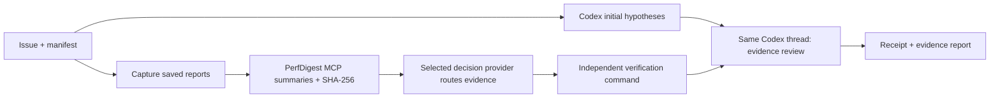

# Technical reference

Detailed usage, provider, security and package reference. Moved verbatim from the README so the README can serve as a short entry point; see [README](../README.md).

## Quick start

Requirements: Node.js 22+, npm, Python 3.11+ and [uv](https://docs.astral.sh/uv/). TypeScript **6.0.3** and JavaScript dependencies are pinned in `package-lock.json`. Linux is the validated platform.

From this checkout:

```bash
npm ci
npm run build
uv tool install perfdigest-mcp==1.2.0 --with mcp==1.27.2
npm run demo
```

The Python MCP dependency is pinned because PerfDigest 1.2.0 still uses the MCP v1 `FastMCP` interface; an unconstrained fresh install can select incompatible MCP 2.x. The pin matches PerfDigest's source lockfile. The runner continues to invoke the installed tool with `uvx perfdigest-mcp`.

Upstream [1.2.1](https://pypi.org/project/perfdigest-mcp/1.2.1/) now bounds the legacy SDK, and [1.3.0](https://pypi.org/project/perfdigest-mcp/1.3.0/) migrates to MCP SDK 2.3. The plugin's TypeScript MCP client 1.32.1 separately passed actual stdio discovery and calls to all seven tools against a clean PyPI 1.3.0 installation on Python 3.14.3. The established hackathon CI installation pin above remains unchanged; this supplemental compatibility check is recorded separately from that baseline.

In an unconfigured workspace, the demo performs genuine CPU work, saves a Chrome trace, digests it through `uvx perfdigest-mcp`, and verifies both traversal algorithms against an independent arithmetic formula. It makes **no model calls** without a saved provider selection or explicit inference flag. `--perf` additionally collects Linux process counters when `perf` and the required permissions are available. It fails explicitly if capture is unavailable.

The package also includes the [recorded genuine Cloudflare/Codex example](../examples/recorded-cloudflare/README.md), its original trace, decision request and receipt. Replay it without credentials from the checkout or installed package directory:

```bash
node dist/cli.js run examples/recorded-cloudflare/manifest.json --workspace examples/recorded-cloudflare --provider offline --agent none
```

This explicitly offline replay digests the saved bytes and reruns verification. It does not make a new inference call or create a fresh performance measurement.

For a real Codex review using your existing ChatGPT login:

```bash
codex login status
npm run demo -- --agent codex --routing offline
```

The runner finds the existing `codex` on `PATH`; `PERFDIGEST_CODEX_PATH` can select another existing binary. It requires ChatGPT authentication and does not copy login tokens. An optional `--model` selects a model available to that login; otherwise the existing Codex configuration determines the model. Codex usage is still consumed in this mode. Tested with CLI/SDK **0.162.1**.

## Evidence flow



The worker starts before the first model turn is requested. Evidence is delivered in the next turn of the **same** Codex thread. This is ordinary evidence handoff; nothing is injected into hidden reasoning. The timeline measures actual overlap with `turn.started`. Fast evidence can finish before the model begins; that correctly records zero overlap.

With an inference provider, PerfDigest first gathers bounded top-three summaries from up to eight declared reports. The selected provider chooses which measured report to deliver for review, or abstains; selected evidence is reused and all input hashes are checked again. Offline mode digests only the first report. Codex examines the hypothesis and alternatives. Verification is an explicit command whose result cannot be overridden by confidence or model prose. This MVP applies no patches. Provider selection is a bounded four-way switch, not a general orchestration framework.

| Mode | Routing | Model access | Evidence |
| --- | --- | --- | --- |
| Default demo | First declared report, deterministic | None | Real CPU execution + Python MCP |
| `--agent codex --routing offline` | First declared report | Existing ChatGPT Codex session | Real local evidence, then Codex review |
| `--agent codex --routing decisions` | Official Decisions API | Separate Decisions key + ChatGPT Codex | Adapter implemented; live Decisions validation pending |
| `npm test` | Synthetic HTTP and subprocess fixtures | Loopback only; no external/model requests | Contract and failure tests; not a live API result |

## Decision providers

Configure the installed package with `npx --no-install perfdigest-plugin init`. The interactive menu offers Cloudflare, local llama.cpp and OpenAI; offline is an explicit deterministic option. There is no interactive npm lifecycle hook. Noninteractive automation uses `perfdigest-plugin init --provider offline --yes`. See the [setup guide](SETUP.md) for private env-file references, endpoint checks and automation.

The saved provider is used by subsequent CLI runs and the MCP worker's default mode. Explicit `--provider`/`--routing` takes priority. Setup checks executable presence and local health without making hosted inference calls. A prerequisite pass does not claim authenticated inference; missing prerequisites exit nonzero and retain the chosen provider visibly.

`init --check-connection` explicitly adds one authenticated, read-only Cloudflare model-discovery request. It validates that read endpoint with a 5-second/64-KiB limit and no retries or redirects; it does not run inference or determine remaining quota. Default setup makes no hosted request.

Select `--provider cloudflare|local|openai|offline` explicitly. The previous names `clef-cloudflare`, `clef-local`, `openai-luna` and `--routing decisions` remain aliases. Every run records the selected provider; errors never switch it to another provider or a fixture.

| Provider | Model/transport | Credential | Current qualification |
| --- | --- | --- | --- |
| `cloudflare` | `@cf/cloudflare/clef-flash`, Workers AI REST | Dedicated account ID + token | Genuine measured-evidence routing + same-thread Astra/max review + independent verification passed |
| `local` | Clef-flash, llama.cpp `/v1/systemone` | None; loopback only | Genuine Q4_K_M inference on RTX 4060/Vulkan passed native question checks; measured route returned `needs_review` below the unchanged confidence threshold |
| `openai` | `gpt-6-luna`, official OpenAI SDK | Dedicated Decisions key | Measured HTTP mock passes; valid-key inference pending |
| `offline` | First report, deterministic | None | Real CPU/PerfDigest/verification validated; no decision inference |

Cloudflare configuration uses `PERFDIGEST_CLOUDFLARE_ACCOUNT_ID` and `PERFDIGEST_CLOUDFLARE_API_TOKEN`. Store them in a private environment file **outside the repository**, with Unix permissions `600`. No token belongs in command arguments, configuration JSON, receipts or Git. The child-process allowlist also excludes both Cloudflare variables.

```bash
node --env-file=/absolute/private/cloudflare.env dist/cli.js demo --provider cloudflare --agent codex
```

Workers AI's documented free allocation is 10,000 Neurons/day. Account eligibility and remaining usage must be checked in the dashboard; this runner does not promise unlimited free inference or upgrade a plan. See [Cloudflare pricing](https://developers.cloudflare.com/workers-ai/platform/pricing/) and the [REST token setup](https://developers.cloudflare.com/workers-ai/get-started/rest-api/). Tokens need Workers AI Read/Edit permissions, scoped to the intended account.

Start the local server with `--alias clef-flash`; unexpected response model identities are rejected. For a separately running local server, set `PERFDIGEST_CLEF_URL=http://127.0.0.1:8137/v1/systemone`. The adapter uses a persistent HTTP server; it never loads a model per request. The official [Clef GGUF repository](https://huggingface.co/ggml-org/Clef-Flash-GGUF) supplies Q4_K_M. Use a Clef-capable [llama.cpp release](https://github.com/ggml-org/llama.cpp/releases); its entire decision prompt must fit `--ubatch-size`. Example settings to assess on your hardware are `--ctx-size 2048 --batch-size 2048 --ubatch-size 2048 --parallel 1`; reduce GPU layers if memory is insufficient. These are configuration suggestions, not a hardware fit guarantee.

Capture CUDA performance evidence **before loading local Clef**, or unload its server before measuring. Then route the saved, hashed artifacts with `captures: []`. Do not present measurements taken under local inference load as isolated GPU benchmarks.

The mapping converts OpenAI-style predicate questions to `noul`, choices to `choice/criteria`, and ordered score levels to `score/criteria`. It preserves returned probabilities and confidence, rejects missing fields, and never replaces missing metrics with zero. SystemOne confidence is zero at a uniform choice distribution; it is not the chosen option's probability or a correctness proof, and it is not assumed calibrated like another provider. Reported zero output tokens are retained. See the [native endpoint contract](https://github.com/ggml-org/llama.cpp/blob/master/tools/server/README.md#post-v1systemone-typesafe-compatible-system-one-api) and [Cloudflare Clef schema](https://developers.cloudflare.com/workers-ai/models/clef-flash/).

The real integration diagnostic is opt-in, excluded from default CI, and makes one decision request:

```bash
PERFDIGEST_RUN_CLEF_INTEGRATION=1 node --env-file=/absolute/private/cloudflare.env scripts/check-clef-live.mjs --provider cloudflare --codex
# Local: use a manifest captured before loading Clef and record the actual quantization.
PERFDIGEST_RUN_CLEF_INTEGRATION=1 node scripts/check-clef-live.mjs --provider local --manifest /absolute/saved/manifest.json --workspace /absolute/saved --quantization Q4_K_M --codex
```

`--codex` uses the existing ChatGPT login with Astra/max. Receipts record provider/model, decision probabilities, hashes, latency, wall time, verification and same-thread Codex delivery. A localhost response alone does not prove which weights produced it: local qualification also requires an independently recorded server process, runtime and GGUF hash. A caller-supplied quantization label is not model verification. Without the opt-in flag the diagnostic sends nothing. Public CI uses fixtures only and needs no hosted credential.

## Use your own reports

```json
{
  "version": 1,
  "issue": "Why did this CPU workload slow down?",
  "captures": [],
  "reports": [{
    "id": "cpu",
    "path": "reports/cpu.perf-stat.json",
    "format": "perf-stat-json",
    "description": "CPU cycles and instructions from the reproducer"
  }],
  "verification": {
    "command": "python3",
    "args": ["tests/verify_reproducer.py"],
    "timeoutMs": 30000
  }
}
```

```bash
node dist/cli.js run manifest.json --workspace /path/to/project --routing offline --agent codex
```

Reports are existing files inside the workspace, at most 20 MiB each, with an explicit PerfDigest format. Directory-shaped reports are outside this MVP. An optional `captures` list accepts up to four `{command, args, timeoutMs}` entries; commands run without a shell and must succeed and refresh the declared reports. Only run manifests whose commands you trust. Verification is required even when using saved reports. Capture/verification commands use a limited environment; activate a needed toolchain through its executable path or `PATH`.

Each run saves `.perfdigest/runs/<id>/run.json` and `report.md`: command receipts, report hashes, raw references, missing metrics, route provenance, Codex usage, errors and timestamps. Raw reports remain on disk. A failed or cancelled capture, changed report, empty digest or failed verification produces a failed run. Abstention/low routing confidence produces `needs_review`. Both exit nonzero. `complete` means the declared pipeline succeeded, not that an arbitrary diagnosis or patch was proved correct.

`run.json` also records `provenance`: one entry per digested report (`id`, `reference`, `format`, `sha256`, `bytes`, `modifiedAt`, `provenance: "perfdigest_mcp"`, `delivered`). It is retained when routing abstains, when a provider response is rejected and when a provider request fails, so the measured inputs of every routing attempt stay auditable; `delivered` is true only for evidence handed to the agent. `decisionOutcome` is `accepted`, `abstained` (refusal, human review or confidence below the unchanged 0.65 policy), `rejected` (schema or model-identity validation failed), `failed` (transport, authentication, billing or other provider error) or `not_reached` (the run failed before routing). Both `run.json` and `report.md` are written with mode 600.

Missing measurements remain `null`. Billing is not observed, so `costUsd` stays `null`; token usage is reported only when provided by the service. The controlled CPU demo is not a real PyTorch issue and one timing sample is not a speedup claim.

## Decisions authentication and deferred integration

The adapter calls `client.decisions.create()` with `gpt-6-luna`, one explicit choice question, a 20-second timeout and no retries. Routing input includes issue text, report IDs/formats/descriptions, artifact hashes and a numeric allowlist from genuine PerfDigest summaries. It preserves zero, null and `not_available_in_this_export` distinctly. Raw contents, local paths, unit names and arbitrary report fields are not sent. SDK logging and redirects are disabled, including when `OPENAI_LOG=debug` is inherited. Responses and exceptions never log provider bodies or headers. Refusal, unknown choices, invalid confidence, HTTP errors and cancellation never silently switch to offline success. The 0.65 confidence cutoff is a routing policy, not a correctness threshold.

Use **`PERFDIGEST_DECISIONS_API_KEY`** in the standalone runner's environment. The adapter never falls back to `OPENAI_API_KEY`. Keep its env file outside the investigated repository and protect it with mode 600. Node can load that file for the runner without putting the key on the command line:

```bash
node --env-file=/absolute/private/decisions.env dist/cli.js demo --agent codex --routing decisions
```

The runner supplies an explicit child-environment allowlist to Codex, profiler commands and Python MCP. It omits Decisions and generic API credentials while preserving `HOME`/`CODEX_HOME` for the existing login. Inherited MCP servers are disabled for the runner's Codex calls with per-process overrides; global configuration is not edited. This controls environment inheritance, not OS-level access by code already running as your user.

Error receipts distinguish `missing_credential`, `authentication`, `billing`, `schema`, `network`, `rate_limit`, `permission`, `service` and `cancelled`; no case falls back to mock or offline data. A generic 429 is a rate limit, while known quota/billing codes are billing failures. Missing credentials fail before capture or Codex startup. A `local_mock` receipt is never live inference evidence.

Run the local HTTP end-to-end check without an API key:

```bash
npm run test:decisions-http
# Optional: same local mock, real existing ChatGPT Codex session (Astra/max):
npm run test:decisions-http -- --codex
```

The default check uses genuine CPU measurements and Python MCP, a real loopback HTTP server, the official OpenAI SDK and a synthetic Codex executable through the actual Codex SDK. `--codex` consumes Codex usage; Decisions remains local mock. Both validate the same-thread handoff and independent verifier.

The separate authentication-boundary check is **explicitly opt-in and disabled in CI**:

```bash
npm run build
PERFDIGEST_RUN_AUTH_BOUNDARY=1 npm run test:decisions-auth-boundary
```

It never reads a real key: it makes one POST to `https://api.openai.com/v1/decisions` with synthetic data and an intentionally invalid credential, expecting 401. Retries and redirects are disabled. It validates rejection at the authentication boundary only: no billing, valid-key access, model availability or inference claim follows from it. Any other response fails the diagnostic. Without the flag, no request is sent.

Successful live integration remains **opt-in and disabled in CI**. Once a real key and budget are supplied, enable the one-request real-evidence check explicitly:

```bash
PERFDIGEST_RUN_LIVE_DECISIONS=1 node --env-file=/absolute/private/decisions.env scripts/check-decisions-live.mjs
```

Without that flag it prints `SKIPPED` and sends nothing. This captures a small CPU trace, obtains its real PerfDigest digest and makes exactly one Decisions request, then runs the independent verifier. No Codex model call occurs in this diagnostic. It does not establish arbitrary diagnosis quality or a performance improvement. The existing standalone demo can use the same key without architectural changes.

## npm package and Codex plugin

```bash
npm pack
npm install --prefix /path/to/local-tools ./perfdigest-plugin-0.1.0.tgz
export PATH="/path/to/local-tools/node_modules/.bin:$PATH"
perfdigest-plugin demo
```

This installs into your chosen prefix. Ensure this executable and `uvx` are on the `PATH` of the Codex process that loads the plugin. The package includes `.codex-plugin/plugin.json`, `.mcp.json` and `skills/perfdigest-evidence/SKILL.md`.

To register the checkout as a local Codex marketplace after installing the executable:

```bash
npm run plugin:prepare
codex plugin marketplace add /absolute/path/to/perfdigest-plugin
codex plugin add perfdigest-evidence@perfdigest-local
```

The preparation step copies only plugin metadata and the skill into `work/codex-plugin`; the marketplace points there, keeping dependencies and run receipts out of Codex's plugin cache. Registration updates the Codex configuration of the invoking user. Installation/listing and both MCP registrations have been checked with CLI 0.162.1 in a separate Codex configuration. Desktop UI activation is not yet validated. See the [official local plugin instructions](https://developers.openai.com/plugins/build/plugins#install-a-local-plugin-manually).

The evidence MCP provides three tools:

| Tool | Behavior |
| --- | --- |
| `launch_evidence_prefetch` | Return a job ID immediately; digest existing reports asynchronously. Offline unless setup selects another default. |
| `get_evidence_job` | Poll with at most 5 seconds of waiting; consume the terminal result once. |
| `cancel_evidence_job` | Abort collection and release the job slot. |

Jobs have a 90-second deadline, expire after five minutes, and are limited to 32 retained jobs. This MCP surface does not expose arbitrary capture commands. The bundled Python MCP also supplies lazy metric expansion and comparison. Plugin MCP Decisions mode needs a key in its **own server process**; do not export the key into the parent Codex session. Use the standalone runner for the documented separate-auth full workflow.

## Development and CI

```bash
npm test                 # SDK, loopback HTTP, subprocess and MCP failure tests; no model calls
npm run test:local       # Real Python MCP discovery, CPU capture and verification
npm run test:package     # Actual tarball, clean prefix install, real offline demo and MCP discovery
npm run check            # All of the above, including the TypeScript build
npm run test:decisions-live  # Skipped unless explicitly enabled
```

GitHub Actions runs these non-model checks on Linux/Node 22 with pinned action revisions and read-only repository permissions. No API key or Codex login is required. Hosted CI status must be checked on the actual GitHub run; a local pass is not a hosted CI pass.

## Controlled evidence comparison

Run from a source checkout:

```bash
npm run benchmark:evidence -- --trials 3                # No model calls
npm run benchmark:evidence -- --trials 1 --agent codex  # Existing ChatGPT login; Astra/max by default
```

This bounded experiment captures the CPU example once and reuses its SHA-256-checked bytes in three arms: **A**, scripted raw-report delivery; **B**, a real PerfDigest digest after the initial hypothesis; **C**, a network-free Decisions SDK fixture and early digest collection. Three trials rotate all arm positions. Results and failures are saved under `work/benchmark/` after each arm. With `--agent codex`, each arm gets a fresh two-turn thread, actual usage and overlap timings, and a narrow reading grade against the original trace and independent verifier. Without a model, token usage and the reading grade remain unmeasured. Fixture tokens are never counted as observed usage; cost stays unknown.

The intended full comparison remains A: ordinary autonomous tools, B: PerfDigest, C: **live** Decisions + PerfDigest + early evidence on a real debugging task. The controlled experiment does not establish routing quality, diagnosis accuracy, cost savings or speedup. Its tiny two-span trace can be **smaller than the digest**, whose provenance and metric metadata have overhead. See [the evaluation protocol](EVALUATION.md) and [the submission walkthrough](HACKATHON.md). The real PyTorch demo issue remains unselected.

